# Building Block View

## Level 0: system context

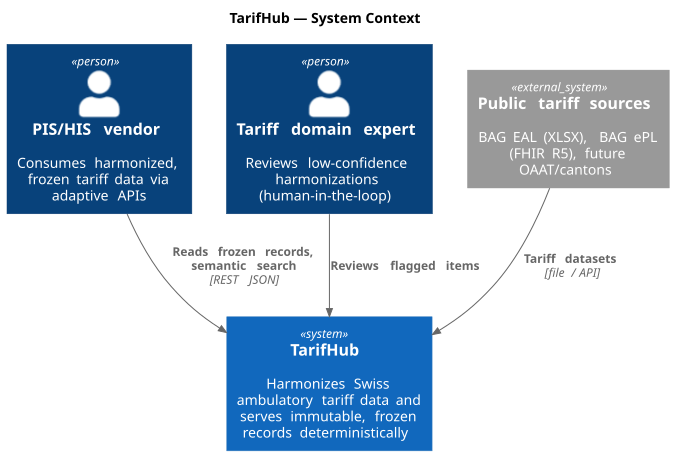

tarifhub ingests Swiss ambulatory tariff sources (BAG EAL XLSX, FHIR catalogues), harmonises them once pre-freeze, and serves immutable frozen records to humans (TarifGuard console), machines (REST/FHIR clients) and AI assistants (MCP). All consumers read from the same deterministic serving layer. Nothing downstream of the freeze line writes.

## Level 1: containers

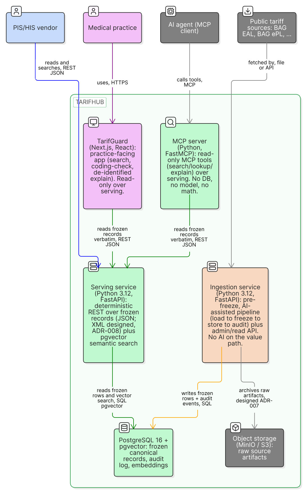

| Container | Repo path | Layer | Responsibility |
|-----------|-----------|-------|----------------|
| Ingestion service | `services/ingestion/` | L0 | AI-assisted harmonisation pipeline: load → parse → map → validate → score → flag → freeze → store → audit |
| Serving API (TarifCore) | `services/serving/` | L1 | Read-only REST: list/get tariffs (incl. `?as_of=` point-in-time), version diff, deterministic semantic search (pgvector on Postgres, in-process cosine offline, [ADR-017](../adr/017-deterministic-search-fallback-explain.md)), record-grounded `/api/v1/explain`, FHIR R4 read adapter (ChargeItemDefinition/CodeSystem). The generated OpenAPI document is committed at `services/serving/openapi.json` and drift-tested against `app.openapi()` (see [§8](08-crosscutting-concepts.md)). No write path, no LLM client importable (AST-tested) |
| MCP server (TarifMCP) | `services/mcp/` | L1 | `search_tariffs`, `get_tariff`, `explain_record`: read-only httpx proxies to the serving API, returning frozen records verbatim |
| TarifGuard console | `apps/tarifguard/` | L3 | Four surfaces over the serving API: master-detail search, frozen-record detail, a human review form (the one write path, backed by the ingestion review endpoint), and a labelled AI explain panel with server-side de-identification |
| KassenFlow, MeldePilot | `apps/kassenflow/`, `apps/meldepilot/` | L3 (out of platform scope) | Out-of-scope future-work demo stubs ([ADR-013](../adr/013-demo-scope.md)), not part of the graded MVP. Planned as thin read-only Next.js clients over serving (L1) and TarifIQ (L2) that compute no billing value, packaged like every sub-system (Dockerfile + Helm) but shipped `enabled: false` and not yet wired up. Listed here so the building-block view matches what Compose and Helm deploy ([§7](07-deployment-view.md)) |
| Database | `db/` | n/a | PostgreSQL 16 + pgvector, `schema.sql` + forward-only migrations, the only contract between L0 and L1 |
| Deployment | `deploy/` | n/a | docker-compose + Helm/k3d, container-first distribution evidence |

L2 (intelligence: rules, crosswalk reasoning) is post-CAS scope as a *feature*: an offline-tested scaffold exists at `services/intelligence/` (TarifIQ: frozen rule table, combinability evaluation, TARMED↔TARDOC crosswalk), and the **graded MVP value path is L0 ingestion → L1 serving/MCP → L3 console**. L2 is not part of it. The scaffold is, however, packaged like every other sub-system (its own Dockerfile, compose service and Helm template), so it can be brought up alongside the stack for completeness. That deployment fact is shown in [§7](07-deployment-view.md). L2 stays read-only and post-freeze (it reads frozen facts from L1), so including its container never touches the value path.

The two L3 apps **KassenFlow** and **MeldePilot** are the same kind of out-of-scope scaffold one layer up: future-work Next.js stubs (payer correspondence / Kostengutsprache and mandatory reporting, respectively) intended to read the deterministic platform like the console but not part of the graded MVP, as their READMEs and [ADR-013](../adr/013-demo-scope.md) state. They are packaged like every other sub-system so Compose and Helm can bring up the full topology, but they ship `enabled: false` in the chart and nothing is wired up. They appear in the container table above only so the building-block view matches what the deployment actually contains ([§7](07-deployment-view.md)).

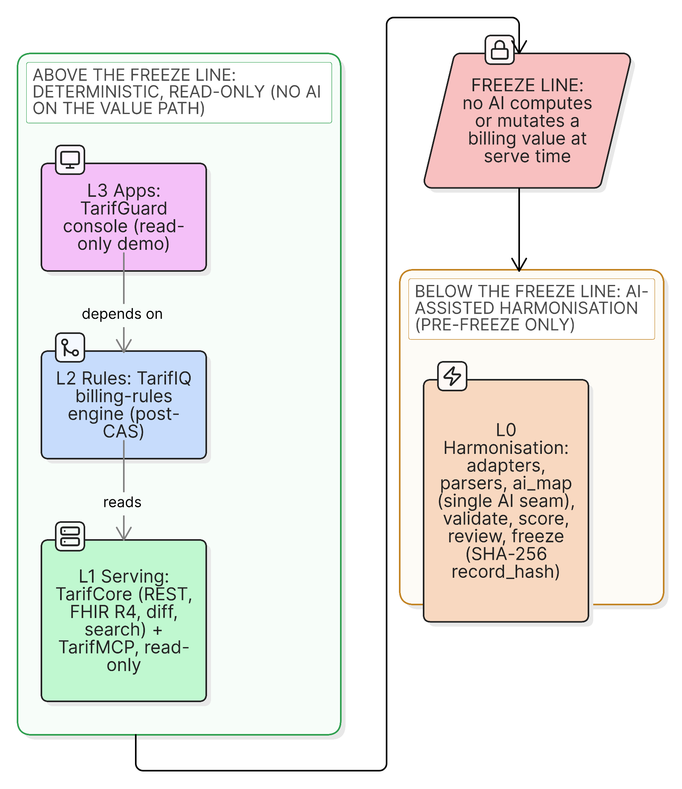

> **Figure: The four layers and the freeze line.** A freeze-line-aware view of the same containers: the L0 ingestion pipeline above the line, and the L1 serving and MCP read paths, the L2 rules scaffold, and the L3 console below it. No AI runs on the value path below the line.

## Level 2: ingestion service components

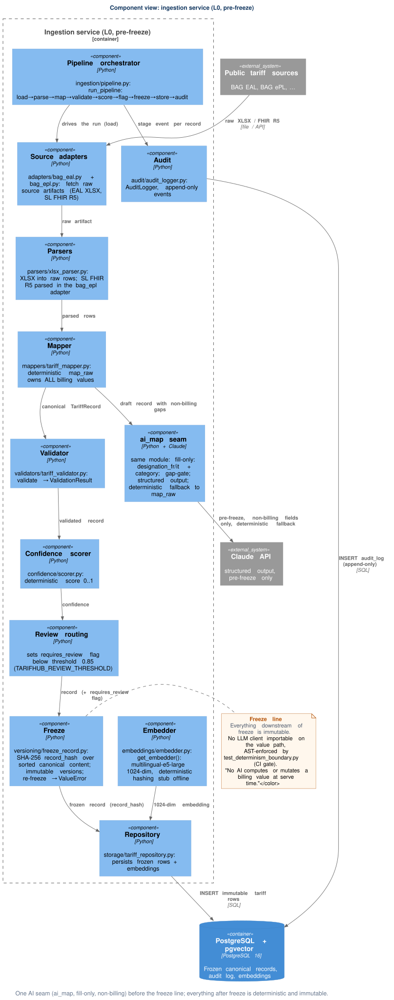

Within the services, ingestion is the only place where live AI runs, and only at the `map` step, consistent with the value-path invariant: no AI computes or mutates a billing value at serve time. The commentary pilot is a second, read-only AI seam outside every service ([below](#outside-the-services-the-commentary-rag-pilot), [ADR-025](../adr/025-commentary-retrieval.md)).

| Component | Module (under `services/ingestion/src/tarifhub_ingest/`) | Responsibility |
|-----------|-----------------------------------------------------------|----------------|
| Adapters | `adapters/bag_eal.py`, `adapters/bag_epl.py` | Source-specific acquisition and parsing into raw rows: BAG EAL (XLSX) and the BAG ePL Spezialitätenliste (the specialty medicines list, FHIR R5 NDJSON, streamed and traversed inside the adapter, [ADR-015](../adr/015-epl-sl-fhir-ingestion.md)) |
| Parsers | `parsers/xlsx_parser.py` | Generic XLSX parsing into raw row dicts with a pinned parser version. The EAL and SL sources parse inside their own adapters, so there is no standalone FHIR parser module |
| Mapper | `mappers/tariff_mapper.py` (`map_raw`) | Deterministic mapping to the canonical `TariffRecord`, owns **all billing values** |
| `ai_map` seam | `mappers/tariff_mapper.py` (`ai_map`, `AIRefinement`) | The **only live-AI point inside the services** (the commentary pilot outside them is described [below](#outside-the-services-the-commentary-rag-pilot)): fill-only on non-billing fields, deterministic gap-gate decides whether to call at all, structured output via `messages.parse`, deterministic fallback to `map_raw` without an API key |
| Validator | `validators/tariff_validator.py` (`validate`, `ValidationResult`) | Schema and business-rule checks. Failures fail closed into review |
| Confidence scorer | `confidence/scorer.py` (`score`) | Deterministic harmonisation-confidence score per record |
| Review routing | `ingestion/pipeline.py` (`requires_review`) | Flags records with confidence below `TARIFHUB_REVIEW_THRESHOLD` (default 0.85) or failed validation for human review |
| Freeze | `versioning/freeze_record.py` (`freeze`, `compute_record_hash`, `verify`) | SHA-256 `record_hash` over sorted canonical content. Freezing an already-frozen record raises `ValueError`. Updates are new versions |
| Audit | `audit/audit_logger.py` (`AuditLogger`) | Append-only lineage event per pipeline outcome |
| Embedder | `embeddings/embedder.py` (`Embedder` protocol, `HashingEmbedder`, `get_embedder`) | Search embeddings only, never on the value path. Deterministic hashing stub offline |
| Repository | `storage/tariff_repository.py`, `storage/db.py` | Persistence of frozen records + embeddings, idempotent on `record_hash` |
| Pipeline orchestrator | `ingestion/pipeline.py` (`run_pipeline`) | Fixed stage order `load → parse → map → validate → score → flag → freeze → store → audit`, pure function of sorted inputs |

## Data model

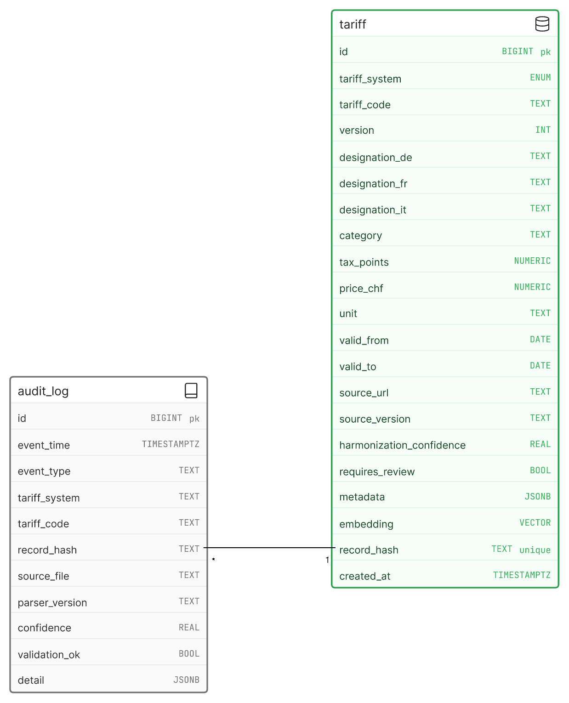

> **Figure: logical data model.** The crow's-foot notation is logical, not physical: `db/schema.sql` declares no FOREIGN KEY constraints. Rows are immutable and `audit_log` is append-only, anchored to `tariff` by `record_hash` value, so lineage is preserved by the append-only write path rather than by referential actions in the engine.

Two tables. `tariff` holds immutable versioned rows: `UNIQUE(tariff_system, tariff_code, version)` makes versions explicit, `record_hash UNIQUE` (SHA-256 over sorted canonical content) is the integrity anchor and idempotency key, and `embedding vector(1024)` carries the pgvector HNSW cosine index for semantic search. `audit_log` is append-only lineage, keyed by `record_hash`: every freeze and skipped re-ingest leaves an event.

Canonical DDL: the forward-only migrations in `db/migrations/` (`001_init.sql` is the greenfield baseline), with `db/schema.sql` as the consolidated current-state snapshot that CI and the Postgres-enabled parity harnesses apply, mirrored in SQLite for offline tests. The field set is locked additive-only per [ADR-003](../adr/003-canonical-record-model.md). The Pydantic model (`models/tariff_model.py`, `TariffRecord`) is the same shape end-to-end.

## Level 3: TarifGuard console components

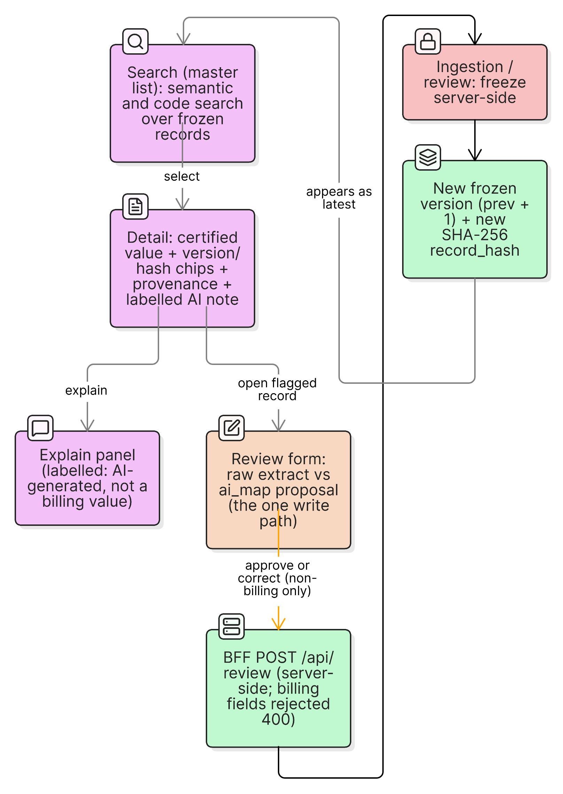

> **Figure: The console master-detail and the one write path.** Search opens the frozen-record detail and the labelled explain panel. The review form is the single place the console writes, and an approval is frozen server-side as a new version with a new record hash. Billing values are never AI-filled.

The TarifGuard console (`apps/tarifguard/`, Next.js App Router with React and Tailwind) is the platform's trust surface, and it computes nothing of its own: every billing value it shows is an unaltered frozen record relayed from the serving API. It has four components, scoped by [ADR-013](../adr/013-demo-scope.md). The master list (`/search`) runs semantic search (`GET /api/v1/search`) and code or system browse (`GET /api/v1/tariffs`). Each result opens the detail panel (`/tariffs/{system}/{code}`), which renders the certified value with its version and truncated `record_hash` chips, the validity window, the source provenance link, the deterministic version history, and a crosswalk hint where the same code exists in another system. The explain panel (`/explain`) calls the deterministic `GET /api/v1/explain` with a tariff code only, and presents the record-grounded explanation on a clearly labelled AI surface. A small coding-check page, accepted in ADR-013 as a demo extra, looks up pasted positions structurally (existence, review flag, validity window) and computes no combinability verdict.

The review form (`/review`) is the human-in-the-loop made operable, and it is the one place the console writes. A flagged record (one whose `requires_review` flag is set) shows the deterministic raw extract beside the `ai_map` proposal, field by field, with the harmonisation confidence and the proposing model named. The reviewer approves the proposal verbatim or corrects any non-billing field, and the record is frozen server-side. The billing values (`tax_points`, `price_chf`) are never AI-filled and stay certified throughout. This write path goes through the console's own API route (`app/api/review`), never the database and never `freeze()` directly. The ingestion review endpoint behind `INGEST_BASE_URL` is implemented (`GET /review/queue`, `POST /review`, [ADR-013](../adr/013-demo-scope.md)): a decision flows console to ingestion `POST /review`, then deterministic `validate`, then `freeze`, then an append-only audit event, then a new immutable version, so an approved or corrected mapping becomes a real frozen successor (version + 1, new `record_hash`), and the same deterministic billing guard rejects any attempt to correct `tax_points` or `price_chf`. With `INGEST_BASE_URL` unset the route still serves a fixture queue offline and simulates the freeze with a genuine SHA-256 over the decided content, so the proposal-to-frozen transition is tangible without a backend. Setting it switches to the live endpoint with no change to the UI.

Two boundaries are visible in the interface and enforced in code. The visual law (mirrored from `docs/brand/tokens.css`) renders every frozen value in navy JetBrains Mono with version and hash chips, and every AI output on a slate surface carrying its fixed guardrail label that it is not a billing value. The two are never blended in one element. The de-identification seam (ADR-012, `lib/deident.ts`) is the only sanctioned builder of any model-bound payload: the explain seam accepts a tariff code only, and any optional free-text context is scrubbed server-side and shown as an audit, never forwarded. Both boundaries are designed to be tested at the component level. Vitest component specs and an offline Playwright smoke (search to detail to a mocked review-freeze to explain, asserting in a real browser that frozen values resolve to navy and that the AI label is present) exist in the repository under `apps/tarifguard/tests` and `apps/tarifguard/e2e`, and they are wired to the `package.json` `test` script (`vitest run && playwright test`), which has run in CI since the console landed (PR #16). The CI `console` job (`.github/workflows/ci.yml`) runs `npm ci`, lint, build, installs Chromium, and then the suite: 40 Vitest tests across six files (all green) plus a Playwright end-to-end smoke (the gate runs 1 end-to-end test green and skips a `CAPTURE`-gated screenshot spec). The current state of console testing, with the quoted CI result, is detailed in [§13](13-test-strategy.md#console-component-tests).

### Console screenshots

Master list: search over frozen records, with certified values in navy mono and version plus hash chips.

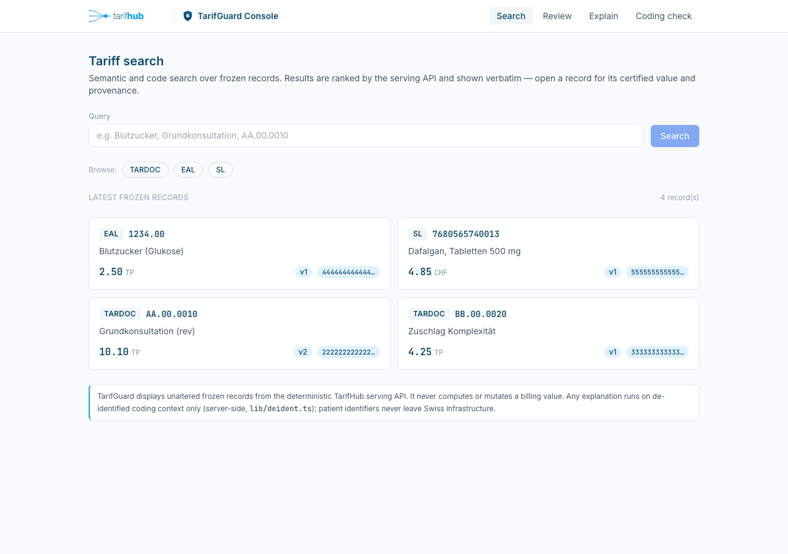

Frozen-record detail: the certified value, provenance, multilingual designation, and the AI-assisted harmonisation disclosed as a labelled note, never as a value.

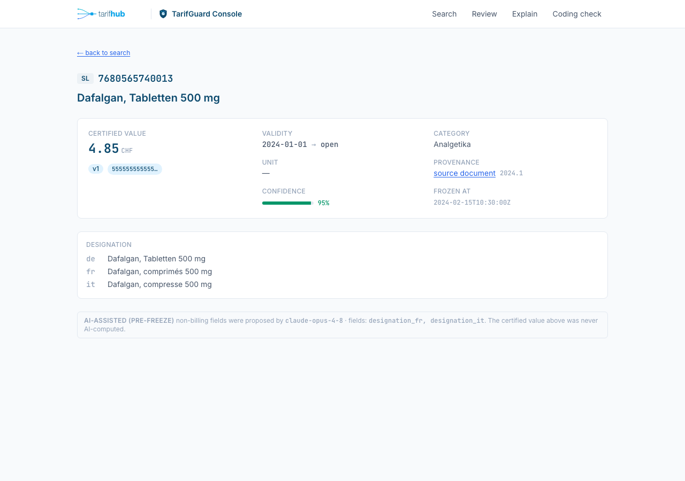

Review form: the raw extract beside the `ai_map` proposal, with billing values certified and excluded from AI editing.

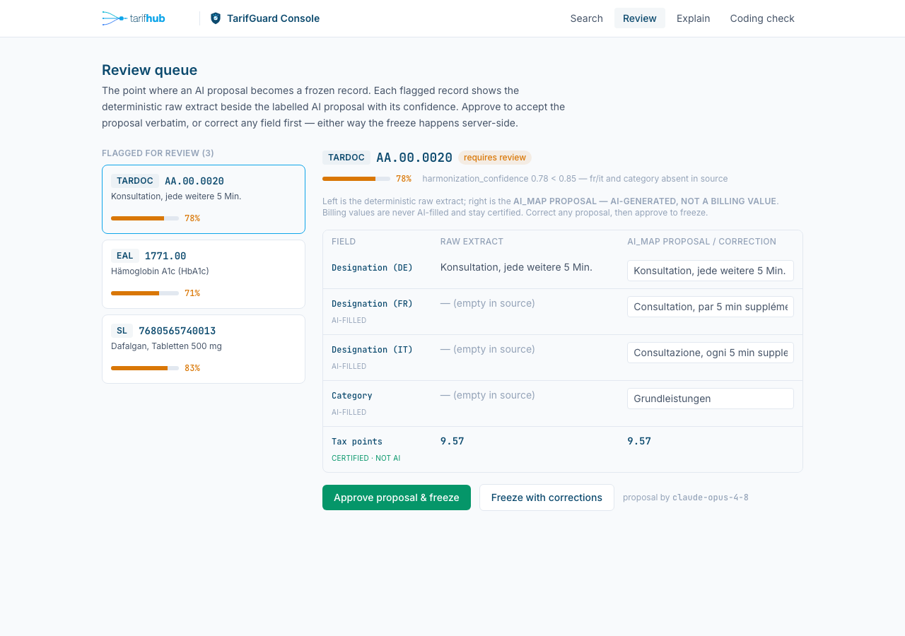

The approve action, where a proposal becomes a frozen record with a new version and a real SHA-256 record hash.

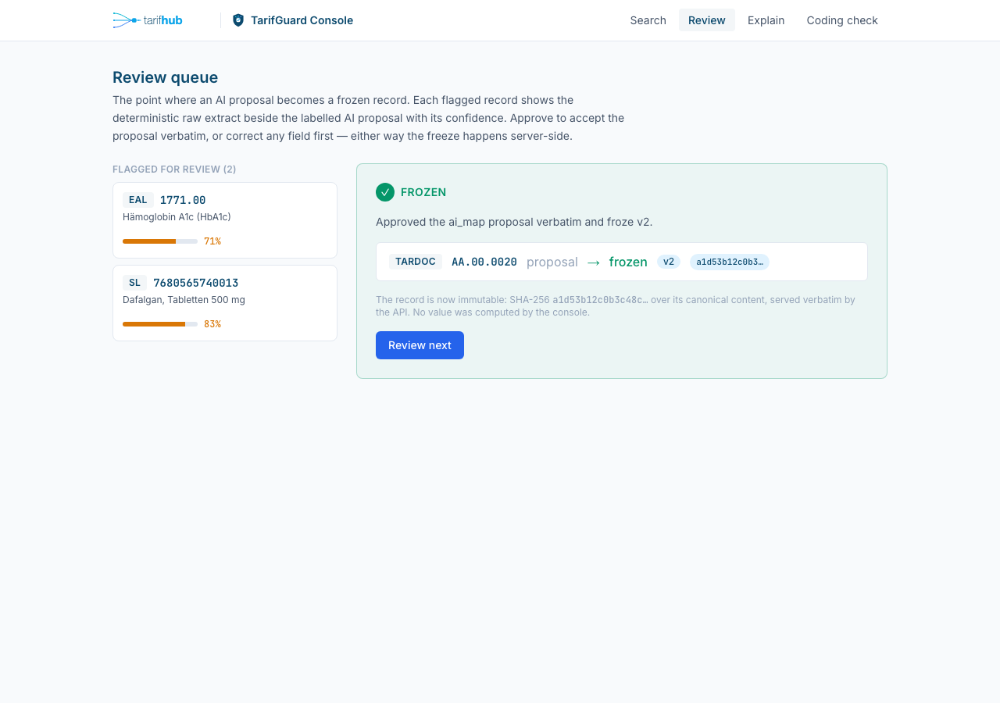

Explain panel (UC-09, live): the explanation renders on the labelled AI surface. It is deterministic and rule-generated, assembled only from record fields and prefixed `[deterministic]`, never invented, while the matching record versions below it appear verbatim with their version and truncated `record_hash` chips. The panel takes a tariff code plus an optional clinical-context field, which is de-identified server-side so that the serving explain seam receives the code alone and no model is ever called.

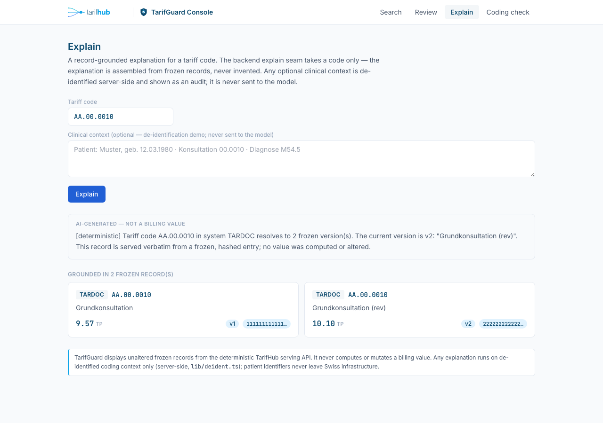

## Outside the services: the commentary RAG pilot

`tools/commentary_rag/` answers questions about the BAG commentaries on the changes to the Analysenliste with passages cited by edition, document and page ([ADR-025](../adr/025-commentary-retrieval.md)). It is a local command-line tool, not a container: it has no image, no port and no database connection, and serving, MCP and the console neither call it nor show its output. It depends on the ingestion service in one direction only, importing the manifest loader with its hash check and the e5 embedder; no service imports the tool.

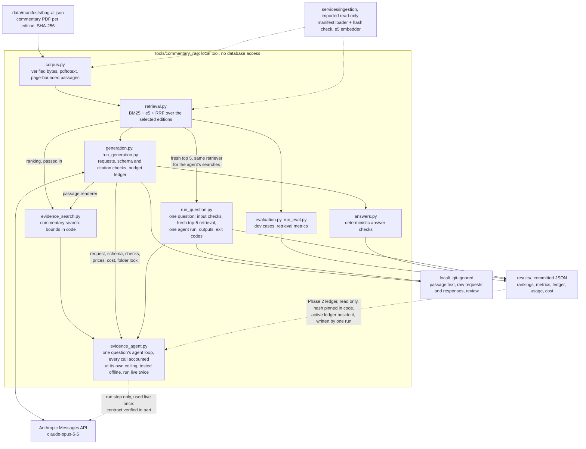

> **Figure: The commentary pilot and its dependencies.** The pilot reads the hash-verified commentary PDFs through the ingestion manifest loader, ranks their passages and sends the top five per question to Claude. Dashed: imports from the ingestion service. The commentary search ranks with a retriever passed in and renders its results with the passage renderer of `generation.py`; it makes no model call. The agent loop takes a provider client as a parameter and is tested against a mocked HTTP transport. Its callers are `run_question.py`, which ranks one question afresh and hands it to the loop once, and `run_comparison.py`, which hands each question to it under three conditions; only their explicit `run` steps build a live client, and each has been executed once (the one-question runner on 2026-11-20 for dev case D1, [evidence](../evidence/2026-11-20-phase3-d1-agent-run.md); the comparison runner on 2026-11-21 for E1 to E6, [evidence](../evidence/2026-11-21-phase3-E-comparison.md)), so the loop's edge to the API stays dotted and its contract is verified only for what those runs exercised. The runner writes a public record of metadata to `results/` and the answer, the raw requests and responses and the full result to `local/`. Dotted from `results/`: the loop's books, the recorded Phase 2 ledger it reads, whose SHA-256 the agent's code pins, and the one active ledger beside it that all later spending goes to; those two runs have written it, and the tests use temporary copies. From `generation.py` the agent takes the request content, schema, checks, prices, cost calculation and folder lock, but computes its own ceiling. The pilot has no edge to the database or to the serving, MCP and console containers above.

| Module | Responsibility |
|---|---|
| `corpus.py` | Reads each edition's commentary PDF through the ingestion manifest loader and hash check and hands the verified bytes to `pdftotext`. Builds passages that never cross a page, each carrying its edition, document SHA-256, BAG URL, PDF page, printed page label (checked against the page index) and section. `build_commentaries` reads a commentary-only manifest instead (`kind` `commentary_sources`), for commentaries an edition date cannot key (two of one date, one covering two), and puts each source ID where the edition date goes |
| `retrieval.py` | BM25, multilingual-e5 (the ingestion embedder) and their reciprocal rank fusion over an explicit edition selection: a passage of an unselected edition is never a candidate |
| `evaluation.py`, `run_eval.py` | The dev cases with verbatim evidence quotes, the retrieval metrics, the recorded retrieval runs and their recomputation from the stored rankings |
| `generation.py` | One Messages request per case (the question, the selected editions and five passages with provenance, sent as escaped, untrusted data, and nothing else), the answer schema (status, claims with passage citations, missing evidence), local schema and citation-membership checks, and the spending guard (token count, reserved ceiling, append-only ledger, attempt cap, no client retries) |
| `answers.py` | Deterministic checks of the answers that keep retrieval misses, generation failures and abstention apart. Checks, not semantic or legal validation |
| `run_generation.py` | The steps `prepare` (retrieval rerun and contexts), `plan` (token counts and cost ceilings), `run` (requests, then the record) and `report`. No step overwrites an output an earlier run wrote |
| `evidence_search.py` | The **commentary search** of the evidence-seeking agent ([ADR-026](../adr/026-commentary-evidence-search.md), proposed): one search request in, the next state and a result out. It ranks only the question's selected editions with the hybrid ranking and returns, from the top 10, at most `min(5, remaining capacity)` passages not yet supplied, as escaped passage data; at most 10 passages per question and two search rounds, refused and failed requests included. Malformed, out-of-scope and repeated requests are refused without ranking, a failed ranking becomes a tool error. Its record holds metadata only; the tool result carries passage text and, like the raw query, seeking and error text, is kept for local artifacts. Built and tested offline; called only by the agent loop |
| `evidence_agent.py` | The **evidence-seeking agent**'s loop for one question, tested offline and run live in two invocations, its **live provider contract verified only in part** (the D1 run and the comparison's six agent cells, two calls and one search each; no third call, second search, error, timeout or deadline path): the Phase 2 request content and system prompt plus a generic search instruction, one tool, at most three generation calls, a conversation that only grows by appending (each assistant turn as returned, then the tool result for its tool-use ID), the tool sent with `tool_choice` none on the last call or once searches or passages are used up, an answer accepted only when it matches the schema and cites only supplied passages, no retries. Provider errors, incomplete responses, protocol violations, invalid answers and the cooperative per-question deadline end the case as distinct outcomes. Every call is accounted under one aggregate limit of USD 100 for Phase 2 and Phase 3 (Phase 2's prices, cost calculation and folder lock, held for the whole question, and the historical ledger's hash pinned in the code): one conservative ceiling, the margin's input at the dearest input rate plus the full output allowance times the US multiplier, rounded up, serves admission (three calls at the 80,000-token input cap must fit) and every reservation; each call is counted, saved and reserved before it is sent and settled once from its validated usage, or kept at its reservation when nothing can be priced; failed writes, damaged or altered books and repeated cases stop before sending. Since 2026-11-21 it serves the three comparison conditions, fixed in code and chosen by name: A (`fixed5`) and B (`fixed10`) send the Phase 2 request with the question's top 5 or top 10 once, without any tool, admitted at one call's ceiling; C (`agent`) is the loop above. Every ledger event carries its condition and every call the ID `<case>-<condition>-call<n>`, so a case and condition is one identity in the books (the D1 run, written before conditions existed, is the agent's); every reservation also records the question's SHA-256 and editions, and a case booked before with another question or editions is refused under any condition. Its callers are `run_question.py` and `run_comparison.py`. Since 2026-11-25 (Phase 4, [ADR-027](../adr/027-coverage-decision.md), proposed) it also serves D (`coverage`): the agent with an explicit coverage decision (its own appended instruction, a search tool that also takes the coverage and the missing part it looks for, the coverage beside the unchanged answer object), whose search is refused as a tool error that uses the round when the coverage is malformed, names a passage not received or names no missing part, and whose answer is accepted exactly as the agent's; the tool is offered by capacity alone. Since 2026-11-26 ([ADR-028](../adr/028-phase4-books.md)) Phase 4 has its own books: a caller that gives a repetition books B, C or D in `results/phase4-ledger.jsonl` under USD 40 and the identity (repetition, case, condition); the code admits repetition 1 only, and D is refused in the Phase 2 and 3 books. Tested offline only |
| `run_question.py` | The **one-question runner** of the agent ([ADR-026](../adr/026-commentary-evidence-search.md)): exactly one question, a stable case ID (its identity in the books, so a new output tag cannot run it twice), an explicit edition selection and a finite time budget, checked before anything is loaded. It builds the verified corpus with the cached e5 model (offline mode forced; a missing model or the stub is refused, a question over the model's input is refused, not truncated), ranks the question afresh (hybrid, selected editions, top 5) and passes only the question, its ID and editions and those passages to one `run_case` call, with the same retriever for the agent's searches and the books, limit, prices and settings fixed in code. `prepare` stops before any client or ledger; the live step is the explicit `run`. The answer and the full result stay in `local/`; the public record holds provenance, the initial ranking by ID and named metadata of the agent's record. Execution, answer and accounting status are reported apart, and the exit code puts persistence failures, a cost above a reservation and unpriced calls before refusals and unanswered cases, so a valid answer exits 0 only when every call was priced within its reservation. Tested offline; run live once, for dev case D1 on 2026-11-20 ([evidence](../evidence/2026-11-20-phase3-d1-agent-run.md)) |
| `run_comparison.py` | The **comparison runner** of Phase 3 ([ADR-026](../adr/026-commentary-evidence-search.md)), built and tested offline on 2026-11-21 and run live once the same day, on E1 to E6 (18 cells, 24 calls, USD 4.569196 calculated; [evidence](../evidence/2026-11-21-phase3-E-comparison.md)). Its input is a cases file holding each case's ID, question and editions and nothing else (a reference answer, gold evidence or a rubric is refused). `plan` reads the books without the lock and prints the matrix, its order, each condition's bounds, the admission headroom (every cell still to run at its worst case, a bound) and estimates from earlier usage settlements, labelled as such; it loads, counts, sends and writes nothing. `run` refuses a matrix whose worst case does not fit (and every cell's admission holds back the cells still to run after it) and a case whose cells in the books were asked something else or recorded no question, loads the verified corpus and the cached e5 model once, ranks every case (hybrid, its editions only) before any cell runs and runs the cells case by case, A, B and C of a case together, each through one `run_case` call with the top 5, 10 or 5 of that ranking and the same time budget. It stops after a cell that needs a person, keeps the outputs of every cell that ended even on an unexpected error, and publishes metadata only. Since 2026-11-25 a Phase 4 design (`--design phase4`, [ADR-027](../adr/027-coverage-decision.md)) runs B, C and D per case and publishes no passage ID; the default Phase 3 design is unchanged. Since 2026-11-26 ([ADR-028](../adr/028-phase4-books.md)) that design books in Phase 4's own books under repetition 1, takes only the frozen runner input and the frozen corpus, admits case by case (a case starts only when the worst case of its cells still to run fits beside everything committed, under the lock), stops after a cell that booked nothing, keeps the books' pinned time budget (written with the first reservation as one event after its request is saved, since 2026-11-27) and refuses a symbolic link as its local folder. Since 2026-11-27 both designs claim the run's local folder before the model loads, so a second invocation under the tag, of either design, is refused, and a Phase 4 cell that an unexpected error or an interruption ends is recorded in the run's outputs before the run stops (written once the run booked anything; the calls its run demonstrably sent, each with its saved complete response, make it a cell that ran and failed, with the searches it recorded and D's coverage entries for those calls). Tested offline and rehearsed with a simulated provider, not run live |
| `phase4/` | The frozen Phase 4 evaluation ([ADR-027](../adr/027-coverage-decision.md), proposed): the condition contract (`conditions.md`: B, C and D, D's instruction, tool, answer format, checks and records verbatim) and the rubric with the decision thresholds (`rubric-and-thresholds.md`), hashed with the private cases in `results/2026-11-25-phase4-freeze.json` before D was implemented |
| `phase4_scoring.py` | The deterministic **Phase 4 scorer**: from the local records of one repetition (several after a resumed run) and the private frozen cases it checks completeness and identity and rebuilds each C and D cell's decision points by capacity before each call and counts warranted, unnecessary, gap-check and missed useful searches, refused searches and points without action; it implements the thresholds and both outcome tables as pure functions and writes case-level results only to a local path. Since 2026-11-26 it reports amendment A1 (unnecessary search attempts, executed and refused, beside T3), checks every record's time budget and repetition, derives a repetition's completeness itself and takes only the frozen gold file. Tested offline on synthetic records |
| `trace_demo.py`, `phoenix_serve.sh` | An **offline tracing demonstration**, not part of any run: one synthetic question through the real loop with a scripted provider and temporary books, traced from outside the loop's modules to a local Arize Phoenix (OTLP/HTTP on 127.0.0.1; the start script runs Phoenix from an empty environment with its own git-ignored storage and the gRPC receiver disabled). The four spans carry the decision to search or to answer and elapsed times as IDs, codes, counts and hash prefixes, with no text and no cost; the ledgers stay the spending record ([§8](08-crosscutting-concepts.md#observability)) |
| `layout_probe.py` | A **diagnostic** outside the pilot, imported by nothing: for one manifest-verified commentary it sets pdfplumber's character geometry and the PDF's tags beside the Poppler text the corpus is cut from, locates the frozen passages by text SHA-256 and reports heading lines, footnotes and their references. pdfplumber is not a dependency; the probe runs in an ephemeral environment and refuses without it. Recorded on 2026-11-22 ([evidence](../evidence/2026-11-22-pdfplumber-layout-probe.md)) |
| `liteparse_ocr.py` | A **diagnostic** outside the pilot, imported by nothing: it parses one PDF, or one manifest-verified commentary, with LiteParse 2.21.4 and an explicitly chosen backend (OCRia-nano-1 OCR, or the native text with OCR off), keeping each item's source page, the backend the parser resolved and the SHA-256 of every model file. liteparse and the model are in no lockfile, environment or image; the tool runs in an ephemeral environment and refuses without them. Adoption as the corpus parser is not decided (`docs/agents/dev-tooling.md`) |
| `training_inventory.py` | The **Phase 4 training-data inventory**, a diagnostic outside the pilot's runs (nothing imports it): it parses the earlier commentaries of a separate manifest (`data/manifests/bag-al-2024-2025.json`) with `corpus.py`, rebuilds the frozen 2026 corpus and checks it against its record, groups the earlier sections into change families by shared position codes or named projects, drops every family that overlaps the 2026 material, and records IDs, hashes, codes, families and counts without passage text. Offline: the e5 tokenizer, read from the local cache with Hugging Face offline mode forced, counts tokens; nothing is embedded or sent, and an existing record is never replaced. Recorded on 2026-11-23 ([evidence](../evidence/2026-11-23-phase4-training-data-inventory.md)). With `--older-commentaries` it also reads the 2021 to 2023 commentaries of `data/manifests/bag-al-commentaries-2021-2023.json` through `build_commentaries` and records three views (the four, the ten, all fourteen with the families rebuilt across them) and every passage of the baseline and of the older view whose eligibility changes ([evidence](../evidence/2026-11-23-phase4-older-commentaries-inventory.md)) |
| `sign_test_power.py` | The **exact power** of the paired sign test planned for a Phase 4 comparison of the base and a tuned embedder, standard library only, with a deterministic record of its scenarios ([evidence](../evidence/2026-11-23-phase4-training-data-inventory.md#what-the-evaluation-could-establish)) |

Implemented and recorded: retrieval on eight dev cases and one generation run, both described in [§10](10-quality-requirements.md#commentary-rag-pilot-recorded-evaluation), one live run of the agent on dev case D1 ([evidence](../evidence/2026-11-20-phase3-d1-agent-run.md)) and the Phase 3 comparison of fixed top 5, fixed top 10 and the agent on E1 to E6 with its blinded human review ([evidence](../evidence/2026-11-21-phase3-E-comparison.md), summarised in [§10](10-quality-requirements.md#commentary-rag-pilot-recorded-evaluation)). Not built: a service, an API, MCP or console integration, a container, passage storage in PostgreSQL and any production monitoring. Proposed in [ADR-026](../adr/026-commentary-evidence-search.md) and built only in part: of the bounded evidence-seeking agent, the commentary search, the single-question loop with its per-call spending protection and the one-question runner exist and are tested offline against a mocked provider; the comparison of fixed top-5 and top-10 contexts with the agent (`run_comparison.py`, all three conditions on the agent's one accounting path; the Phase 2 runner must not be used to bypass it) is built and tested offline since 2026-11-21 and ran live once the same day, on E1 to E6; the loop has called the provider in the D1 run and in the comparison's six agent cells, which verified the request shape and usage they exercised (two calls and one search each) but no third call, second search, error, timeout or deadline path. Phase 4 ([ADR-027](../adr/027-coverage-decision.md), proposed): the coverage decision D, its evaluation (19 cases, rubric and thresholds, frozen on 2026-11-25 before the code), the comparison runner's Phase 4 design and the deterministic scorer are built and tested offline and dry-run with a simulated provider; no live run. Planned in the second progress report and not yet decided as architecture: a change brief joining the deterministic [edition comparison](../adr/023-al-edition-comparison.md) with the cited commentary answer, and a held-out test set rated blind by a second person. Each would need its own decision before it touches a service.
