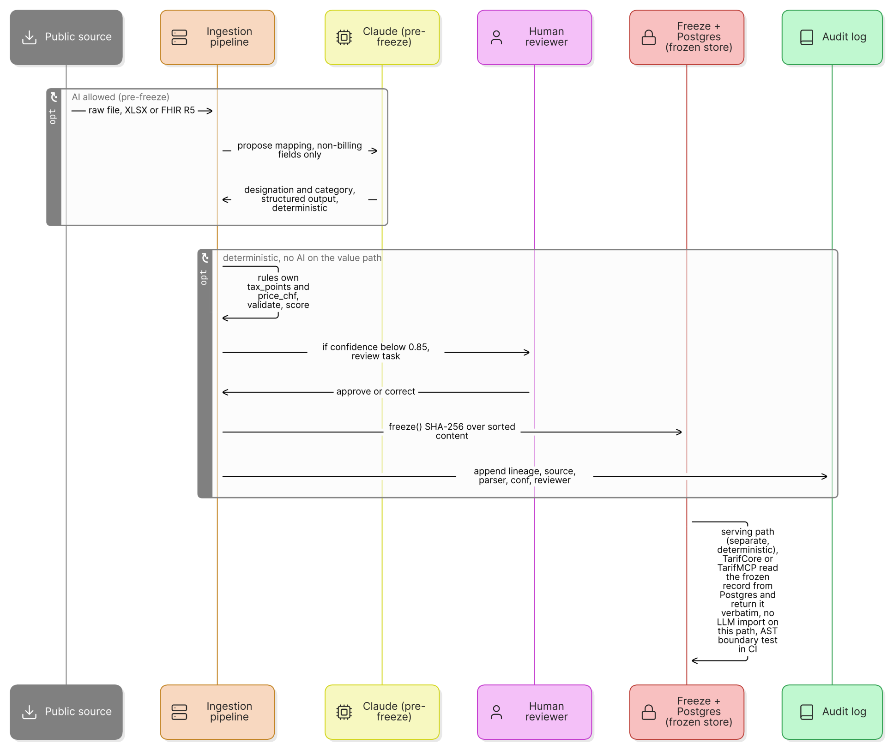
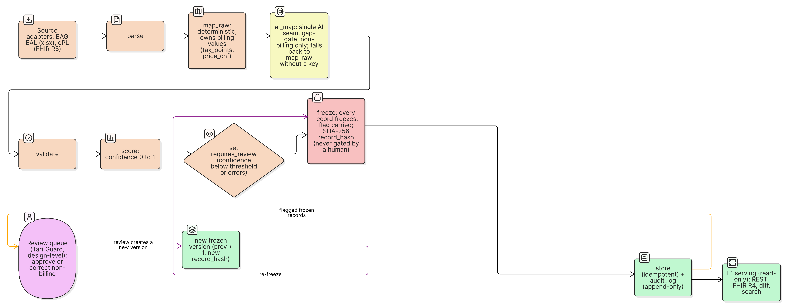
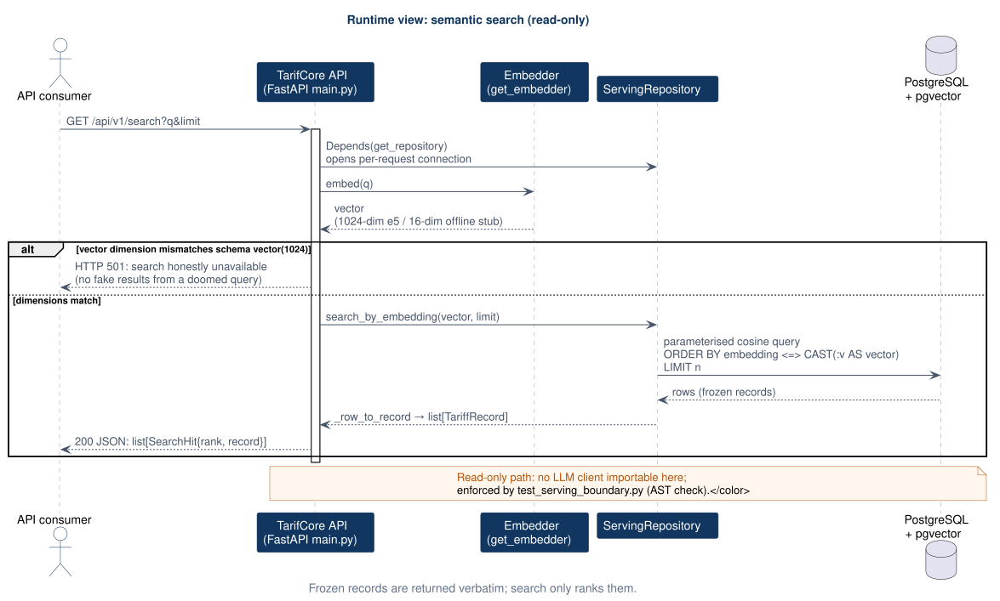
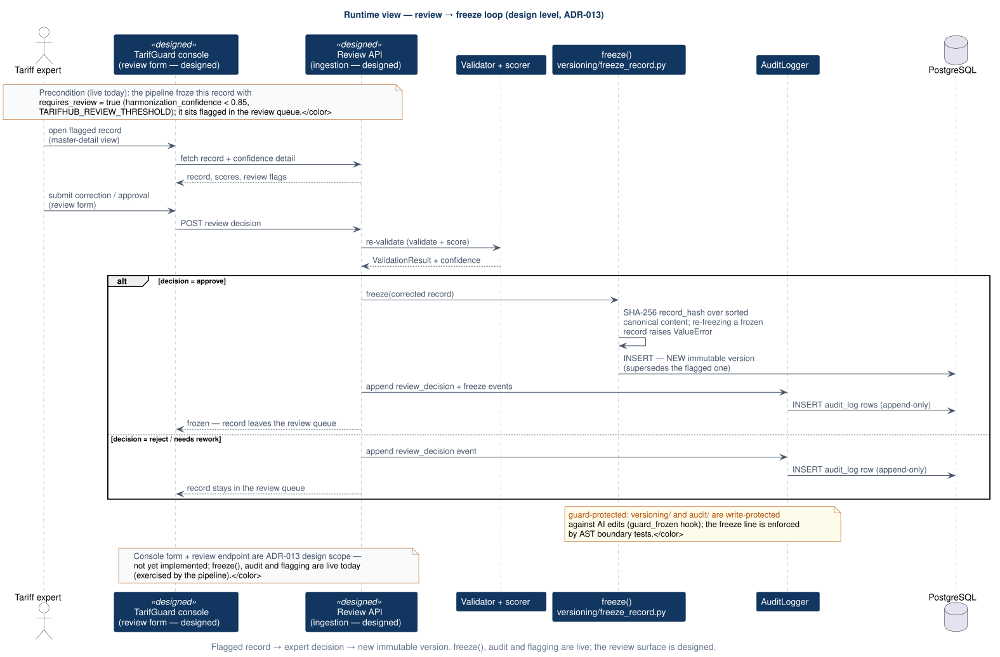
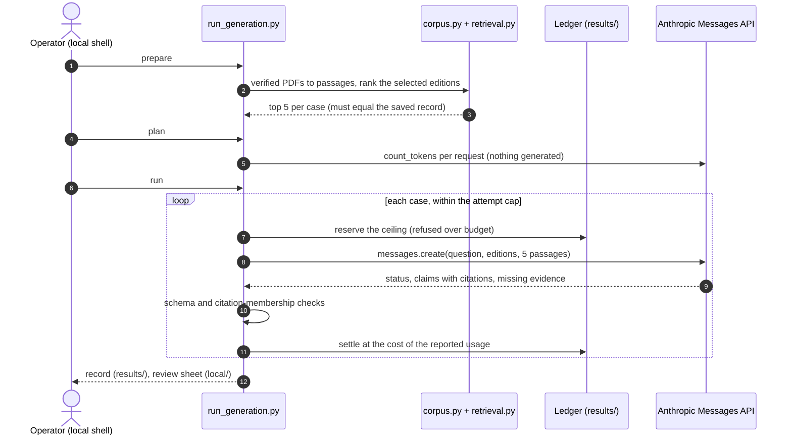
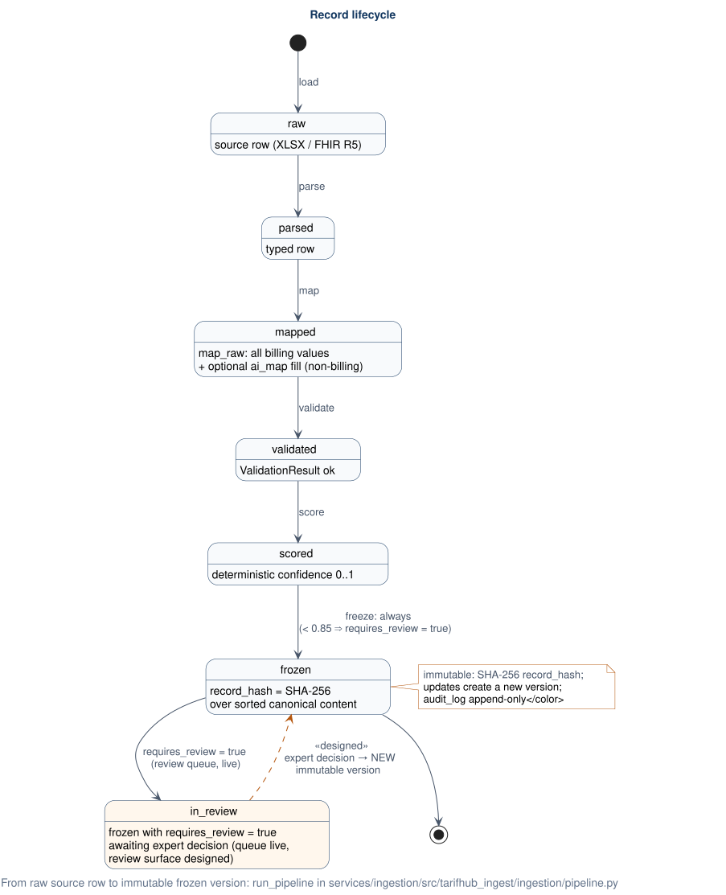
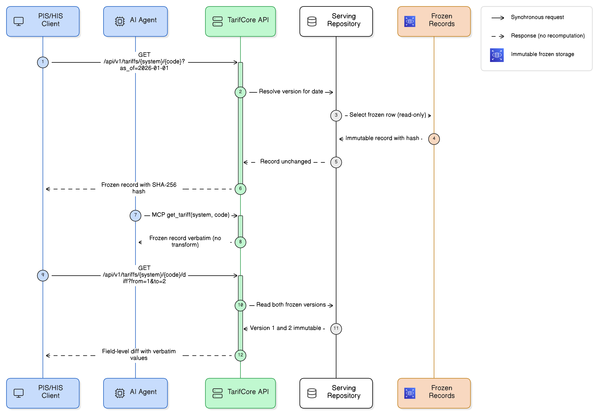

# Runtime View

Three scenarios show the platform at work: the deterministic harmonisation pipeline (live), semantic search through the serving API (live), and the expert review loop (now implemented end to end: the console review form proxies to the ingestion review endpoint, which persists a new frozen version in the store, [ADR-013](../adr/013-demo-scope.md)). Each is traceable to code under `services/`. Across all three, the value-path invariant holds: no AI computes or mutates a billing value at serve time. This is the determinism boundary established in §8 (Crosscutting Concepts). A fourth scenario runs outside the services: the commentary RAG pilot, a local tool that reads no tariff record and writes nothing to the store ([ADR-025](../adr/025-commentary-retrieval.md)).

## Scenario 1: harmonise to freeze (the pipeline)

`run_pipeline` (`services/ingestion/src/tarifhub_ingest/ingestion/pipeline.py`) processes sources in a fixed order: **load → parse → map → validate → score → flag → freeze → store → audit**. It is a pure function of sorted inputs, with no randomness and no wall-clock branching, so the same sources always produce the same frozen records and hashes.

1. **Load + parse.** Source specs are sorted by system and path. A parser is dispatched per source kind (`_PARSERS` in `pipeline.py`): `xlsx_parser` for the generic XLSX kind, the `bag_eal` adapter for the EAL source, and the `bag_epl` adapter for the SL FHIR R5 export ([ADR-015](../adr/015-epl-sl-fhir-ingestion.md)), which streams and traverses the resource graph itself. Each yields raw rows with a pinned parser or adapter version.
2. **Map.** `ai_map` wraps the deterministic `map_raw`, which owns every billing-relevant field. The AI seam is **fill-only** (designation FR/IT, category, [ADR-005](../adr/005-single-ai-seam.md)): a deterministic gap-gate skips the model call entirely when nothing is fillable, and any failure or missing API key falls back to the `map_raw` result unchanged.
3. **Validate + score.** `validate` produces a `ValidationResult`. `score` computes a harmonisation confidence in [0, 1].
4. **Flag.** Confidence below `TARIFHUB_REVIEW_THRESHOLD` (default 0.85) or a validation failure sets `requires_review`. The record still freezes, carrying the flag into the review queue.
5. **Freeze.** `freeze` stamps the SHA-256 `record_hash` over sorted canonical content. Attempting to re-freeze an already-frozen record raises `ValueError`.
6. **Store + audit.** The repository inserts the immutable row (skipping when the hash already exists) and `AuditLogger` appends one event per record: `freeze` or `freeze_skipped_idempotent`.
7. **Idempotency.** Re-running on identical sources yields an identical hash set, so every record is skipped and the audit trail records exactly that.

> **Figure: The end-to-end data flow.** Source adapters, parse, map_raw, the ai_map seam (gap-gated, non-billing fields only), validate, score, and the requires_review flag, then a deterministic freeze (every record freezes, the flag carried, never gated by a human) with the SHA-256 record hash, the idempotent store and append-only audit, and the read-only serving hand-off. Flagged frozen records enter the review queue, where a human review creates a new version.

## Scenario 2: semantic search through serving

`GET /api/v1/search` (`services/serving/src/tarifhub_serving/main.py`) ranks frozen records by cosine similarity to the embedded query. The path is strictly read-only and fails closed rather than degrading silently.

1. A client calls `GET /api/v1/search?q=…&limit=…`. FastAPI injects the repository and settings via dependency injection.
2. The query is embedded with `get_embedder().embed_query`, the same embedder seam that ingestion used to embed the records (e5's asymmetric `query:`/`passage:` prefixes are honoured).
3. **Engine dispatch ([ADR-017](../adr/017-deterministic-search-fallback-explain.md)).** On Postgres, `ServingRepository.search_by_embedding` runs a parameterised pgvector cosine query (`<=>`) over frozen rows. On the offline SQLite mirror the same ranking runs as a **deterministic in-process cosine** over the stored stub embeddings, ties broken by `(tariff_system, tariff_code)`: same response shape, never a faked result.
4. **Dimension guard.** On Postgres, an embedder whose vector does not match the `vector(1024)` column fails closed with an explicit **501** before issuing the doomed pgvector query.
5. Rows are rehydrated verbatim into `TariffRecord` and returned as ranked `SearchHit` items. No field is recomputed or rewritten.
6. **Read-only guarantee.** The AST boundary test (`services/serving/tests/test_serving_boundary.py`) proves no LLM client is importable on this path. CI fails otherwise.

> **Honest note on the embedder.** The default offline build, including CI and the suite a grader runs, ranks on the deterministic 16-dim `HashingEmbedder` stub. The real `intfloat/multilingual-e5-large` embeddings and the pgvector engine are an opt-in `ai` extra. The real semantic ranking is demonstrated deterministically by `services/serving/tests/test_e5_ranking.py` over recorded e5 vectors (the French query *hématocrite* ranks the German record EAL 1375 top-1 within a curated seven-record set, the cross-lingual match the stub cannot make, while the full 1279-record eval ranks 1375 second behind the near-duplicate panel 1372.01), so the intelligent search is shown in evidence without a 2 GB model download.

## Scenario 3: review to freeze loop (implemented end to end)

The console review form (`apps/tarifguard/app/api/review`) GETs the review queue and POSTs an approve/correct decision, and the ingestion review endpoint behind `INGEST_BASE_URL` (`GET /review/queue`, `POST /review`) persists it as a new frozen version in the store. The full loop is implemented and tested: the console BFF proxy is covered by Vitest (see [§13](13-test-strategy.md#console-component-tests)), and the ingestion endpoint by cross-engine API tests (`services/ingestion/tests/test_review_api.py`: approve and correct each yield a new version plus an audit entry, a billing correction is rejected, the prior version stays immutable). The server-side billing-field guard rejects any attempt to correct `tax_points`/`price_chf` (HTTP 400) on both the BFF and the ingestion side. With `INGEST_BASE_URL` unset the route still simulates the freeze offline with a genuine SHA-256 over the decided content. The loop below traces how the pieces close the cycle.

1. The pipeline flags a record (confidence < 0.85 or validation failure). It freezes with `requires_review = true` and enters the review queue, served by `GET /review/queue` *(live)*.
2. A tariff expert opens the flagged record in the console master-detail view and corrects or approves the mapping in the review form, which POSTs the decision to the ingestion endpoint *(live)*.
3. The decision passes back through the same deterministic `validate` in the ingestion service (`POST /review`). An expert edit gets no shortcut around the rules, and a billing-field correction is rejected with HTTP 400 *(live)*.
4. `freeze` produces a **new version** with a new `record_hash` (`version + 1`). The flagged version remains immutable and re-freezing it raises `ValueError` *(live)*.
5. An audit event is appended for the review decision (`review_approve` / `review_correct`) alongside the freeze. The append-only `audit_log` keeps the full lineage *(live)*.
6. The new version carries `requires_review = false` and the record leaves the queue *(live)*.

The freeze line itself is defended in depth: `versioning/` and `audit/` are write-protected against AI edits by the `guard_frozen` hook, and the boundary is CI-enforced by `test_determinism_boundary.py`.

## Scenario 4: a cited explanation from the BAG commentaries (local pilot, outside the services)

The commentary pilot (`tools/commentary_rag/`, [§5](05-building-block-view.md#outside-the-services-the-commentary-rag-pilot)) runs as separate local steps from the repository root, in the ingestion project's environment with its `ai` extra. Nothing in this scenario reads or writes the tariff database, and no step is reachable through serving, MCP or the console.

1. **Build the corpus.** For each AL edition the manifest names a commentary PDF with its SHA-256. The ingestion manifest loader reads and verifies the bytes, `pdftotext` turns exactly those bytes into pages, and each page becomes passages that carry edition, document hash, page, printed page label and section. A missing or mismatching document refuses the run.
2. **Retrieve (`prepare`).** For one question and an explicit edition selection, BM25 and the e5 dense ranking each order the passages of the selected editions only, and reciprocal rank fusion combines them. The top 5 form the case's context. Before any generation the frozen retrieval is rerun and must reproduce the saved record's top 5 and passage hashes, or the step refuses.
3. **Plan.** Each request is counted with the provider's token-counting endpoint and priced at its ceiling (counted input with a 10 % margin plus the full output allowance), with nothing generated.
4. **Generate (`run`).** The contexts must equal the saved record in every field the request carries, and one run at a time holds the ledger's lock. For each case the ceiling is reserved in the append-only ledger, refused if it would pass the budget or the attempt cap, and only then is one request sent. It holds the question, the editions and the five passages as escaped, untrusted data, without tools, web search, fallback model or client retries. The answer must match the schema (status `answered`, `partial` or `insufficient_evidence`, claims with passage citations, missing evidence), and every citation is checked against that request's own passages. A failure is recorded as it came, never repaired.
5. **Record (`report`).** The public record in `results/` keeps configuration, contexts by hash, every attempt with usage and calculated cost, and the deterministic checks. Passage text, raw requests and responses and the human-review sheet stay in the git-ignored `local/` folder. No step overwrites an earlier output.

> **Figure: One pilot run.** The steps are separate local commands. The only network partner is the Anthropic API; the tariff database, serving, MCP and the console take no part.

The recorded run, its checks and the human review are in [§10](10-quality-requirements.md#commentary-rag-pilot-recorded-evaluation).

## Scenario 5: the evidence-seeking agent for one question (tested offline, run live)

The loop of [ADR-026](../adr/026-commentary-evidence-search.md) (proposed, `tools/commentary_rag/evidence_agent.py`) is tested against a mocked provider and temporary ledgers. Its callers, the one-question runner `tools/commentary_rag/run_question.py` and the comparison runner `run_comparison.py` (Scenario 6), are tested the same way; the one-question runner has run live once, for dev case D1 on 2026-11-20 ([evidence](../evidence/2026-11-20-phase3-d1-agent-run.md)): every step below ran (the deadline of step 6 checked, never reached) with two calls, a search request and then an answer requested with `tool_choice` none, since one search had filled the ten-passage budget, both priced within their reservations. The comparison of 2026-11-21 ran the loop in the same way for each of its six agent cells (one search, then an answer requested with `tool_choice` none, every call priced within its reservation; [evidence](../evidence/2026-11-21-phase3-E-comparison.md)). The steps below describe the design; those runs exercised the request shape and usage of two calls only, not a third call, a second search or the error, timeout, deadline or kept-reservation paths.

1. **The runner.** It takes exactly one question, a stable case ID, an explicit edition selection and a finite time budget, and checks them before anything is loaded; outputs of an earlier run under the same tag are refused. It builds the hash-verified corpus with the cached e5 model (offline mode forced, a missing model or the fallback stub refused, a question over the model's input refused rather than truncated) and ranks the question afresh: hybrid, the selected editions only, top 5. Only the question, its ID, its editions and those passages reach the loop, in one `run_case` call that also gets the same retriever for the searches; no dev case, gold evidence or rubric is read. `prepare` stops before this call and builds no client; only the explicit `run` step goes on.
2. **Start.** The question holds the folder lock of its books for its whole run; refused by the lock, it counts, sends and writes nothing. The recorded Phase 2 ledger must still have the hash pinned in the agent's code (a caller can only repeat it, not choose another), the active ledger beside it must read cleanly, and the question must not be in it already under the same condition (here `agent`; a call ID is `<case>-agent-call<n>`). It is admitted only when three calls at the 80,000-token input cap, each at its ceiling, fit beside everything committed under USD 100. The ceiling is the agent's own, one calculation for admission and reservations: the counted input with a 10 % margin at the dearest input rate, the full output allowance and the US data-residency multiplier, rounded up to a micro-dollar (USD 1.4784 at the cap). The first request carries the Phase 2 content for the question (its editions and fixed top-5 passages), the Phase 2 system prompt with a short instruction to search for what the passages do not state, and one tool, the commentary search. One monotonic deadline is set for the question.
3. **Each call.** If time is left, the request is token-counted with a timeout no longer than the time left, refused above the input cap, saved and reserved at its ceiling under its call ID. The deadline is checked again: a request it stops is recorded as never sent, which releases the reservation. Otherwise the request is sent once. The raw response is saved and the call settled, at the cost of its validated usage or, when nothing can be priced (a timeout, an error response, missing usage), at its whole reservation. A failed write stops the question: a sent call, or one whose release could not be saved, stays reserved. Every request carries the search tool; `tool_choice` is `auto` unless this is the third call or the two searches or the ten passages are used up, and `none` then.
4. **A search request.** Exactly one call of the known tool is run by code within the search bounds; anything else (an unknown tool, several calls, a call while `tool_choice` was none, a cut-off or declined response) ends the question without running it, and so does a cost above the reservation. The assistant turn is appended as returned and the tool result follows with its tool-use ID; refused and failed searches return as error results and use their round.
5. **An answer.** It is accepted only when it matches the answer schema and cites only passages supplied in this conversation; otherwise the outcome is an invalid answer. An answer with status `insufficient_evidence` is a legitimate outcome, apart from errors. Acceptance never depends on the settlement: a rejected response has been settled all the same.
6. **The deadline.** It is checked before each count, after the count and reservation just before sending, after each call and after each search. Once it has passed, nothing more is counted, sent or searched, and a late response is settled but not used. The check is cooperative: it cannot interrupt a request already sent or a search in progress.
7. **The runner's outputs and exit.** When the case reserved at least one call, or may have (a reservation whose ledger write failed, reported as uncertain accounting), the runner keeps the accepted answer and the full result (with the agent's local part) in `local/` and publishes provenance, the initial ranking by ID and named metadata of the agent's record in `results/`, each write on its own and none followed by a new request; when nothing was reserved, it writes nothing, so the case can run again. It reports execution, answer and accounting status apart. A valid answer exits 0 only when every call was priced within its reservation: a cost above a reservation exits as a spending stop and an unpriced call as uncertain accounting, with the answer still kept locally.

{ width="560" }

> **Figure: One question in the agent loop.** Filled numbers mark where the numbered steps above begin; each outlined 6 marks a deadline check. Every request carries the search tool, with `tool_choice` auto while a search is still allowed and `none` on the third call or once two searches or ten passages are used. In the tests every arrow to the API reaches a mocked transport and every arrow to the books a temporary folder; the live runs (D1, 2026-11-20, and the six agent cells of the comparison, 2026-11-21) reached the Messages API and the repository's books through two passes of the loop each. Any other response ends the question with a distinct outcome: provider error, incomplete generation, protocol error, invalid answer or deadline; a refusal (by the books, or above the input cap), a persistence error or a spending stop also ends it, each before any further request is sent. Drawn with the diagram-design plugin; editable source: [agent-search-answer-loop.html](../diagrams/agent-search-answer-loop.html).

## Scenario 6: the Phase 3 comparison of three conditions (tested offline, run live once)

`tools/commentary_rag/run_comparison.py` ([ADR-026](../adr/026-commentary-evidence-search.md), proposed) runs each question under three conditions, every cell (one case under one condition) through the loop of Scenario 5. It is tested against a mocked provider and temporary ledgers and has run live once, on 2026-11-21 for the frozen set E1 to E6 ([evidence](../evidence/2026-11-21-phase3-E-comparison.md)): all 18 cells answered in the order below, with no stop, 24 calls each reserved and settled from usage, and the outputs of step 5.

1. **Input and plan.** The cases file holds each case's ID, question and editions; any other field is refused before the file is used. `plan` reads the books without the lock and prints the matrix in its order, each condition's bounds, the admission headroom and labelled estimates; it loads no model and counts, sends and writes nothing.
2. **Before any cell.** `run` refuses existing outputs, checks the key's presence, refuses a matrix whose worst case (every cell still to run at its admission: USD 1.4784 for A or B, 4.4352 for C) does not fit beside everything committed under USD 100, and refuses a case whose cells already in the books were asked another question or editions or recorded none. It then loads the verified corpus and the cached e5 model once, checks every case's editions and question length and ranks every case.
3. **One ranking per case.** Each question was ranked once, hybrid over its editions only, before the first cell. A (`fixed5`) receives the top 5 and B (`fixed10`) the top 10 as the Phase 2 request, once, with no tool; C (`agent`) receives the top 5 and may search (Scenario 5). Model, settings, question, editions, passage rendering and the acceptance rule are shared; system prompt, tool, calls and passages differ by design, and so does the use of the one time budget per cell, which A and B spend on one call and C shares across up to three calls and two searches.
4. **The books decide.** Each cell is admitted, reserved and settled by the agent's books under its own identity, the case and its condition, each reservation recording the question's hash and the editions, and each admission holding back the worst case of the matrix's cells still to run after it: a cell already in the books is refused whatever the tag or the entry point, so a repeated run sends nothing again, and a case booked with another question or editions is refused.
5. **Stops and outputs.** The matrix stops, sending nothing further, after a cell with a failed write, a cost above its reservation, a call kept at its reservation or a refusal other than a cell already in the books (a call ID that another case's reservation holds among them). When a cell reserved a call, the questions, answers and traces go to `local/` and metadata only (hashes, IDs, scores, codes, counts, amounts) to `results/`, also for the cells that ended before an unexpected error. A cell already in the books is skipped and sets the exit code only when no cell ran.

## Scenario 7: the Phase 4 comparison of B, C and D (tested offline, not run live)

`run_comparison.py --design phase4` ([ADR-027](../adr/027-coverage-decision.md), proposed) follows Scenario 6 with the conditions B (`fixed10`), C (`agent`) and D (`coverage`) per case, in that order; the default Phase 3 design is unchanged. D starts from the same top 5 as C and runs the loop of Scenario 5 with three differences: its appended instruction asks for the coverage of the question's parts before it acts; a search must name a part it marked missing, and code refuses a coverage that is malformed or names a passage not received, and a search for no missing part, as a tool error that uses the round before anything is ranked; its answer carries the coverage beside the unchanged answer object, which is accepted exactly as C's. The tool is offered by capacity alone, as for C. The public record names no passage; the local record keeps the rankings, passages and coverage text. Until 2026-11-26 admission and books were those of Scenario 6, under which one case is admitted at USD 10.3488 and the frozen set of 19 cases (USD 196.6272) does not fit at once (the dry run of 2026-11-25 ran it in admitted batches, the real books unchanged). Since then ([ADR-028](../adr/028-phase4-books.md)) the design books its cells in Phase 4's own books under repetition 1 and takes only the frozen runner input, so one invocation runs the frozen cases in their order. Before each cell, under the lock, the worst case of the case's cells still to run must fit beside everything committed in those books under USD 40: a fresh case needs USD 10.3488, and the run stops before anything of a case that does not fit is counted or sent. A cell that booked nothing (a failed token count, say) stops the run, so a rerun retries it before anything after it. A rerun after an interruption skips every cell in the books and continues in the frozen order, under the time budget the books pinned; a booking without a settlement stays at its reservation and is never sent again, and its case stays incomplete unless the cell demonstrably sent a call (that call itself, when the run saved its complete response, or an earlier one). Since 2026-11-27 the books' pin is written with their first reservation as one event after that request is saved, both designs claim the run's local folder before the model loads (a second invocation under the tag, of either design, is refused), and a cell that an unexpected error or an interruption ends is recorded in the run's outputs (written once the run booked anything) before the run stops: the calls its run demonstrably sent (its own saved request and complete response, consistent with the books; since 2026-11-28 a zero-byte or cut-short response file proves no send, and books that cannot be read take no part, nor, since the ninth review, a Phase 4 ledger missing when the run recovers, which is restored before any restart: a run started without it finds new books and would book and send every cell again) make it a cell that ran and failed, the searches those calls ran are scored as recorded, D's coverage entry for a call cut off before its search counts among its diagnostics only, a deadline ending after the last booking was released unsent stays the cell's ending when readable books hold that release, and nothing after them is inferred. A simulated rehearsal through this entry point (2026-11-26, repeated on the fixed code on 2026-11-27 and 2026-11-28 with same-tag overlaps, an interruption after a sent call and the replay failure of C and D) ran a complete repetition, resumed interrupted ones, stopped at the cap and saw a concurrent invocation refused by the lock, the real books unchanged ([evidence](../evidence/2026-11-26-phase4-repetition-books-offline.md)). A live run needs Erhan's decision.

## Record lifecycle (states)

A record moves **raw → parsed → mapped → validated → scored → frozen**, with flagged records (`requires_review`) entering the review queue as frozen versions. Frozen is terminal and immutable, so every correction is a new version and every transition an audit event.

## Interface-contract view (the interaction perspective)

The scenarios above show specific behaviours. This view generalises them into the contract every consumer codes against. The interaction perspective is carried by the L1 serving surface itself: the set of typed, read-only operations through which PIS/HIS systems (REST and FHIR R4), AI agents (MCP) and the TarifGuard console reach frozen records. It is enforced by tests rather than asserted in prose, and it is the same surface for every consumer class, so the freeze-line guarantee holds identically whoever calls.

> **Figure: The interface contract in motion.** A point-in-time read over REST (the FHIR R4 ChargeItemDefinition adapter resolves the same way over the same value path), a record fetched verbatim over MCP (`get_tariff`), and a version diff, each served through the read-only repository from immutable frozen storage. The verbatim reads return the stored record unchanged with its canonical SHA-256 hash. `diff` returns the field-level changes between two immutable versions. No billing value is recomputed on the way out.

### The serving surface as a contract

| Interface | Operation | Request contract | Response contract |
| --- | --- | --- | --- |
| REST | `GET /api/v1/tariffs` | `system?`, `as_of?`, `limit`, `offset` | `list[TariffRecord]`, one per key, ordered by `(tariff_system, tariff_code)` |
| REST | `GET /api/v1/tariffs/{system}/{code}` | `as_of?` | `TariffRecord` (latest or point-in-time). Returns `404` if no version matches |
| REST | `GET /api/v1/tariffs/{system}/{code}/diff` | `from`, `to` (versions) | `DiffResponse`: changed fields only, sorted by name. `record_hash`, `version`, `created_at` are never diffed. Returns `404` if either version is missing |
| REST | `GET /api/v1/explain` | `code`, `system?` | `ExplainResponse`: every version of the code plus a rule-generated explanation labelled `[deterministic]`. Returns `404` if unknown |
| REST | `GET /api/v1/search` | `q`, `limit` | `list[SearchHit]`: frozen records ranked by cosine similarity. Returns `501` on Postgres when the embedder is not 1024-dim |
| FHIR R4 | `GET /api/v1/fhir/ChargeItemDefinition/{system}/{code}` | `version?` (wins over) `as_of?` | one R4 `ChargeItemDefinition`. `status` is derived from record data, never the wall-clock. Returns `404` if no record matches |
| FHIR R4 | `GET /api/v1/fhir/CodeSystem/{system}` | `as_of?`, `limit`, `offset` | one R4 `CodeSystem` (`content='fragment'`, `count` is the total number of keys for the selected point in time, independent of the page window). Returns `404` for an unknown or empty system |
| MCP | `search_tariffs`, `get_tariff`, `explain_record` | read-only tool arguments | read-only `httpx` proxies onto the REST surface: `get_tariff` returns a frozen record verbatim, `search_tariffs` returns ranked `SearchHit` wrappers, `explain_record` returns the `explain` payload (records plus the deterministic explanation) |
| Liveness | `GET /health` | none | `{"status": "ok"}` |

**Point-in-time, versioning and diff are part of the contract.** The list and single-record reads, and both FHIR adapters, accept an optional `as_of` date and return, per key, the version whose validity window covers that date (`valid_from <= as_of`, and `valid_to` open or on or after `as_of`, then the highest matching version). Omitting `as_of` returns the latest version. The `ChargeItemDefinition` route additionally accepts an exact `version`, which wins over `as_of`. Versions are explicit and immutable (`UNIQUE(tariff_system, tariff_code, version)`), so a correction is always a new version, and `diff` reports exactly which fields changed between any two of them (`record_hash`, `version` and `created_at` are excluded from the comparison). A point-in-time query means the same thing whether a consumer reads over REST or the FHIR adapter, because both resolve it over the one immutable version history.

### The machine-readable contract is tested, not asserted

The contract is not only narrated here. FastAPI derives an OpenAPI document from the typed route signatures (served at `/openapi.json`, rendered at `/docs`), and `services/serving/tests/test_openapi.py` pins it: the test fixes the exact route surface and fails if a route is added, removed or renamed without an update, and it requires every route to carry an OpenAPI summary, a description and a response model. The acceptance criterion behind it (see [§10, acceptance criteria](10-quality-requirements.md#acceptance-criteria)) therefore cannot erode one undocumented route at a time.

### Determinism is a property of the interface

The contract never recomputes or fabricates a billing value. The billing fields a consumer receives are unaltered, frozen, versioned values read straight from the system of record. The read-only seams around them are deterministic transforms, never value computation: `search` only ranks frozen rows and never rewrites them, `explain` assembles a rule-generated text labelled `[deterministic]` from record fields alone, the FHIR adapters project a frozen record into an R4 resource without touching its values, and a dimension mismatch on `search` fails closed with `501` rather than degrading silently ([ADR-017](../adr/017-deterministic-search-fallback-explain.md)). That no LLM client is even importable on this path is proved structurally by the AST boundary test `services/serving/tests/test_serving_boundary.py`, which CI enforces. The interface is therefore safe to integrate against: no value on it is computed from randomness or the wall-clock, the record fields it returns are the frozen values verbatim, and every frozen record it exposes carries the canonical-content SHA-256 hash that pins its integrity.
